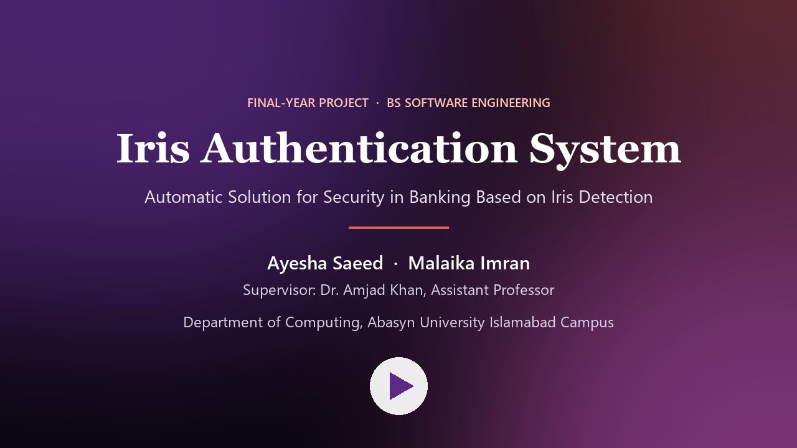

# Iris Authentication System

**Automatic Solution for Security in Banking Based on Iris Detection**: a final-year project for the BS in Software Engineering at Abasyn University, Islamabad Campus.

A custom convolutional neural network (CNN) recognises a person from an image of their iris, and a Django web application uses that model to log users in with an iris image instead of a password.

[](docs/demo.mp4)

▶ **[Watch the demo video](docs/demo.mp4)**: registration, iris-only login, the dashboard and a rejected login attempt, recorded from the running app.

📄 **[Read the thesis (PDF)](docs/thesis.pdf)**: full project report, 128 pages. Student registration numbers have been removed.

---

## Team

| | |
|---|---|
| **Authors** | Ayesha Saeed · Malaika Imran |
| **Supervisor** | Dr. Amjad Khan, Assistant Professor |
| **Institution** | Department of Computing, Abasyn University Islamabad Campus |

## How it works

1. **Dataset**: CASIA-Iris-Thousand: 20,000 eye images (640 × 480), labelled into 2,000 classes (left and right eye of each subject).
2. **Preprocessing**: noise reduction (wavelet denoising, histogram equalisation, Gaussian filtering), normalisation (contrast stretching, histogram normalisation), and resizing to 150 × 150 grayscale.
3. **Localisation**: a hybrid technique that finds the dark pupil region and fixes multiple boundary points, alongside polar and Hough transforms.
4. **Feature extraction and classification**: a custom CNN (see below) predicts which of the 2,000 classes an iris belongs to.
5. **Web authentication**: at sign-up each user is linked to two class IDs. At login the uploaded iris image is preprocessed and classified; the user is logged in only if the predicted class belongs to them and the model's confidence is above 90%.

## Model

The trained model used by the web app (`model.h5`, 3,702,224 parameters):

| Layer group | Details |
|---|---|
| Input | 150 × 150 × 1 (grayscale) |
| Convolution stages 1–7 | Each: Conv2D (Leaky ReLU) → Batch Normalization → MaxPooling → Dropout. Filters 32, 64, 128, 256, 256, 512, 512 · kernels 5×5 (stages 1–3), 3×3 (4–6), 2×2 (7) · dropout 0.1 → 0.5 · Gaussian noise (0.1) after stage 1 |
| Classifier | Flatten → Dense (128, Leaky ReLU) → Dense (2,000, Softmax) |

Training settings reported in the thesis:

| Setting | Value |
|---|---|
| Optimizer | Adam, initial learning rate 0.001 |
| Loss | Sparse categorical cross-entropy |
| Batch size / epochs | 32 / 100, with EarlyStopping, ModelCheckpoint and ReduceLROnPlateau |
| Data split | 80 : 10 : 10 → 16,000 training, 2,000 validation, 2,000 test images |

The thesis describes the network in five blocks; the layer table above is read directly from the trained `model.h5`.

## Results (as reported in the thesis)

| Training accuracy | Validation accuracy | Test accuracy | Precision | Recall | Equal Error Rate |
|---|---|---|---|---|---|
| 99% | 95.83% | 92% | 0.92 | 0.86 | 0.0004 |

The saved outputs in the notebook come from a single training run and can differ slightly from the figures reported in the thesis.

## Tech stack

Python · TensorFlow / Keras · OpenCV · NumPy · pandas · scikit-learn · Matplotlib · Django 4.2 · SQLite · HTML / CSS / JavaScript

## Repository structure

```
iris_auth/                 Django project
├── authentication/        App: custom user model, sign-up, iris login, dashboard
│   ├── utils.py           Image preprocessing and CNN prediction
│   ├── views.py           Sign-up, login (iris upload), logout, dashboard
│   └── templates/         HTML pages
├── iris_auth/             Project settings and URLs
├── static/css/            Stylesheets
└── manage.py
notebook/
└── iris-recognition-cnn.ipynb   Data exploration, preprocessing, CNN training and evaluation
docs/
├── demo.mp4               Demo video
└── thesis.pdf             Project thesis
```

## Running locally

> The trained weights (`model.h5`, 44.6 MB) and the CASIA-Iris-Thousand images are not included in this repository. The weights are available on request for non-commercial research. Place `model.h5` in `iris_auth/` before starting the app.

```bash
cd iris_auth
python -m venv .venv
.venv\Scripts\activate          # Windows  (macOS/Linux: source .venv/bin/activate)
pip install -r ../requirements.txt
set DJANGO_DEBUG=1              # Windows  (macOS/Linux: export DJANGO_DEBUG=1)
python manage.py migrate
python manage.py runserver
```

Open http://127.0.0.1:8000/, create an account at `/signup/`, then log in at `/login/` by uploading an iris image.

### Configuration

| Variable | Purpose |
|---|---|
| `DJANGO_DEBUG` | `1` for local development. Leave unset in deployment. |
| `DJANGO_SECRET_KEY` | Required when debug is off; the app refuses to start without it. |
| `DJANGO_ALLOWED_HOSTS` | Comma-separated host names (default `localhost,127.0.0.1`). |
| `DJANGO_SSL_REDIRECT` | `1` (default) redirects to HTTPS when debug is off. |

With debug off, the app enables secure cookies, HSTS and other Django security headers. Run `python manage.py collectstatic` and serve the app over HTTPS behind a production web server.

### Changes made for publication

The code is the project's original implementation with these clean-ups: the secret key and debug flag moved to environment variables, production security settings added, upload type and size validation (JPEG/PNG/BMP, 5 MB), temporary uploads always deleted, duplicate imports removed, debug `print` statements replaced with logging, and the sign-up page styled to match the login page. The authentication logic is unchanged.

## Dataset

This project uses **CASIA-Iris-Thousand**, collected by the Institute of Automation, Chinese Academy of Sciences (CASIA). The images are not redistributed here; please obtain the dataset from its official source and follow its licence terms. The sample image shown in the demo video (`S5000L00`) is from this dataset.

## Copyright

Copyright © 2024 Ayesha Saeed and Malaika Imran. All rights reserved.
